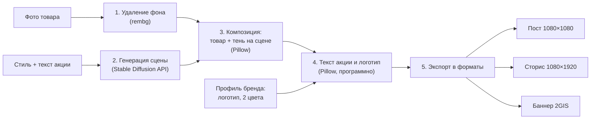
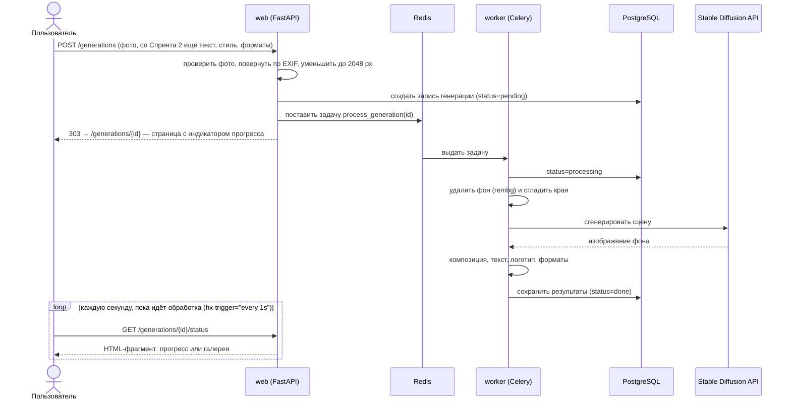
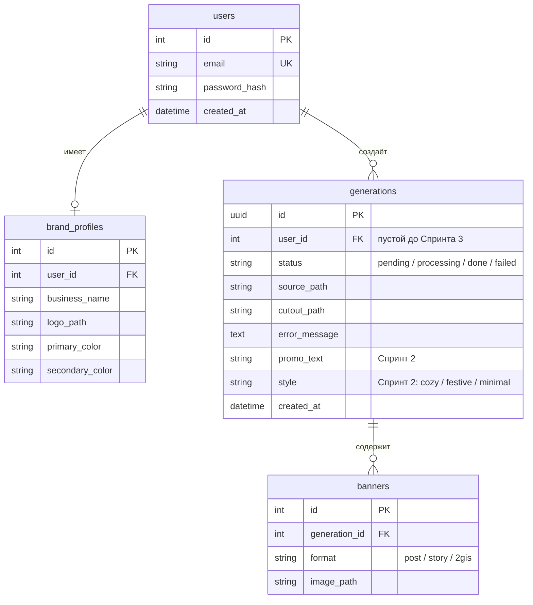

# Архитектура AdGen AI

> Документ для отчётов по дисциплине «Управление проектами».
> Актуален на конец **Спринта 1**. Обновляется в конце каждого спринта.
> Диаграммы написаны на Mermaid: GitHub показывает их как картинки. Для вставки в отчёт
> откройте файл на GitHub или в [mermaid.live](https://mermaid.live) и экспортируйте PNG/SVG.

## 1. Назначение системы

AdGen AI — веб-сервис для малого бизнеса (кафе, магазины, салоны). Пользователь загружает
фото товара, вводит текст акции, выбирает стиль и форматы — сервис возвращает 3–4 готовых
рекламных баннера.

## 2. Компоненты

Система состоит из четырёх контейнеров Docker и внешнего API нейросети.


| Компонент | Технология | Ответственность |
|-----------|------------|-----------------|
| **web** | FastAPI, Jinja2, HTMX, Tailwind CSS | HTML-страницы, приём загрузок, постановка задач, отдача статуса и файлов |
| **worker** | Celery | Долгая обработка изображений в фоне, чтобы веб-запрос не «висел» |
| **db** | PostgreSQL 16 | Пользователи, профили брендов, генерации и их результаты |
| **redis** | Redis 7 | Очередь задач Celery и хранение статусов/результатов задач |
| **media/** | локальная папка (позже — S3-совместимое хранилище) | Исходные фото, промежуточные и готовые изображения |
| **Stable Diffusion API** | Hugging Face Inference API (по умолчанию) | Генерация фоновой сцены по текстовому описанию |

`web` и `worker` собираются из **одного** Docker-образа и различаются только командой запуска —
код общий, поэтому задачи и модели не дублируются.

## 3. Пайплайн генерации баннера



**Почему текст накладывается программно, а не рисуется нейросетью.** Диффузионные модели
плохо генерируют текст: искажают буквы, особенно кириллицу, и путают цифры в ценах.
Для рекламы ошибка в цене недопустима, поэтому нейросеть рисует только фон, а текст и логотип
накладываются через Pillow с фирменными цветами — это точно и предсказуемо.

## 4. Как проходит запрос (асинхронная генерация)

Обработка занимает от нескольких секунд до минуты, поэтому она выполняется в фоне, а страница
опрашивает статус через HTMX. В Спринте 1 воркер выполняет только удаление фона; шаги со сценой,
текстом и форматами добавятся в Спринте 2 в ту же задачу `process_generation`.



## 5. Модель данных

Таблицы добавляются постепенно, каждая — отдельной миграцией Alembic.

`generations.id` — UUID, а не порядковый номер: адреса страниц и файлов (`/generations/<id>`,
`/media/generations/<id>/...`) нельзя подобрать перебором, пока в сервисе нет авторизации.
Файлы хранятся на диске, в базе — только относительные пути к ним.



| Таблица | Спринт | Статус |
|---------|--------|--------|
| `users` | 0 | ✅ создана миграцией `0001` |
| `generations` | 1 | ✅ создана миграцией `0002` (поля текста и стиля добавятся в Спринте 2) |
| `banners` | 2 | план |
| `brand_profiles` | 3 | план |

## 6. Структура проекта

```
ADGen_AI1/
├── app/                      # код приложения (общий для web и worker)
│   ├── main.py               # точка входа FastAPI: подключение роутеров и статики
│   ├── config.py             # настройки из .env (pydantic-settings)
│   ├── db.py                 # подключение к PostgreSQL, базовый класс моделей
│   ├── models.py             # модели SQLAlchemy (таблицы)
│   ├── schemas.py            # Pydantic-схемы ответов JSON API
│   ├── worker.py             # Celery-приложение
│   ├── tasks.py              # фоновые задачи Celery (process_generation)
│   ├── templating.py         # общий объект Jinja2-шаблонов
│   ├── routers/              # обработчики URL
│   │   ├── pages.py          #   главная и фрагмент «Состояние системы»
│   │   ├── generations.py    #   загрузка фото, страница результата, статус для HTMX
│   │   └── api.py            #   JSON: /api/hello, /health, /api/generations/{id}
│   ├── services/             # бизнес-логика, не зависящая от HTTP
│   │   ├── images.py         #   проверка и подготовка загруженного фото
│   │   ├── background.py     #   шаг 1 пайплайна: удаление фона (rembg)
│   │   ├── storage.py        #   сохранение файлов в media/
│   │   └── health.py         #   проверка БД, Redis, Celery
│   ├── templates/            # Jinja2-шаблоны (base.html, страницы, partials/)
│   └── static/               # статика: иконка, js/upload.js (drag & drop)
├── alembic/                  # миграции базы данных
│   └── versions/             #   файлы миграций по порядку
├── tests/                    # pytest
├── docs/ARCHITECTURE.md      # этот документ
├── media/                    # загруженные и сгенерированные файлы (не в git)
├── Dockerfile                # образ для web и worker
├── docker-compose.yml        # web, worker, db, redis
├── requirements*.txt         # зависимости Python
├── pyproject.toml            # настройки ruff и pytest
└── .env.example              # шаблон переменных окружения (сам .env не в git)
```

Каждый шаг пайплайна — отдельный модуль в `app/services/` (сейчас `background.py`, дальше
сцена, композиция, текст, экспорт). Их можно тестировать по отдельности, без веб-сервера
и очереди.

## 7. Технологические решения

| Решение | Почему так |
|---------|------------|
| **FastAPI** | Современный, быстрый, автоматическая документация API (`/docs`), валидация через Pydantic |
| **Jinja2 + HTMX** вместо React/Vue | Весь проект на Python, нет отдельной сборки фронтенда. HTMX даёт динамику (прогресс, подгрузка галереи) атрибутами в HTML |
| **Tailwind CSS через CDN** | Аккуратный адаптивный дизайн без сборки CSS. Для продакшена можно перейти на сборку через Tailwind CLI |
| **Celery + Redis** | Генерация долгая (до минуты) — её нельзя делать внутри HTTP-запроса. Очередь также ограничивает нагрузку на API нейросети |
| **PostgreSQL + SQLAlchemy 2 + Alembic** | Надёжная реляционная БД; миграции фиксируют изменения схемы в git, их легко применить у напарника |
| **Синхронный SQLAlchemy** | Проще в понимании и отладке; FastAPI сам выполняет синхронные обработчики в пуле потоков |
| **Провайдер нейросети настраивается** | `IMAGE_PROVIDER` в `.env` — можно сменить Hugging Face на другой API без переписывания кода |
| **Файлы в `media/`** | Просто для MVP; интерфейс хранения позволит заменить на S3-совместимое хранилище |
| **Docker Compose** | Одна команда поднимает всё окружение одинаково на Windows, macOS и Linux |
| **Секреты только в `.env`** | Пароли и ключи не попадают в git; в репозитории — только шаблон `.env.example` |
| **rembg, модель `isnet-general-use`** | Работает локально и бесплатно, без внешнего API. Эта модель точнее стандартной `u2net` на фото предметов |
| **Модель встроена в Docker-образ** | Скачивается при сборке (~180 МБ), поэтому первая обработка не ждёт загрузку модели |
| **Тесты на SQLite в памяти** | Тесты не требуют запущенных PostgreSQL и Redis: быстро и подходит для CI. Задача Celery вызывается напрямую, нейросеть подменяется заглушкой; один тест с пометкой `slow` проверяет настоящую модель |

## 8. Удаление фона: как устроено и почему так

1. **Проверка в веб-запросе** (`services/images.py`) — сразу, чтобы пользователь увидел ошибку
   на той же странице:
   - файл должен открываться как изображение: проверяется содержимое, а не расширение;
   - допустимые форматы: JPEG, PNG, WebP и MPO (так сохраняют фото многие телефоны и камеры;
     без этого снимки с телефона отклонялись — нашли при тестировании на реальном фото);
   - не больше 10 МБ (`MAX_UPLOAD_MB`), не меньше 200 px по стороне.
2. **Подготовка**: поворот по EXIF (телефоны хранят фото «на боку» с пометкой о повороте),
   уменьшение до 2048 px (для баннера 1080 px больше не нужно, а обработка быстрее),
   прозрачность заменяется белым фоном. Исходник сохраняется в JPEG.
3. **В воркере** (`services/background.py`): rembg строит маску товара, `post_process_mask`
   убирает «мусор» вне товара, затем края маски сужаются на 1 px и слегка размываются.

**Как выбирали обработку краёв.** Сравнили 5 вариантов на двух фото:

| Вариант | Результат | Время (фото 2048 px, замер в Docker) |
|---|---|---|
| Маска как есть | Мусорные пятна вне объекта | 1,1 с |
| `post_process_mask` | Чисто, но тёмная кайма по контуру и «лесенка» | 2,3 с |
| `alpha_matting` | Мягкие края, но размывает контур и очень медленно | 8,4 с |
| **`post_process_mask` + сужение на 1 px + размытие 1 px** | **Чистый контур без каймы** | **2,4 с** |
| то же, сужение на 2 px | Края слишком мягкие | 2,5 с |

**Ресурсы.** Каждый процесс воркера держит модель в памяти (~0,9 ГБ). Воркер запущен
с `--concurrency=2` (две обработки одновременно): ~1,8 ГБ памяти.
Обработка одного фото — 1–5 секунд.

## 9. Окружение и порты

| Сервис | Адрес с компьютера | Адрес внутри Docker |
|--------|-------------------|---------------------|
| web | http://localhost:8000 | `web:8000` |
| db | `localhost:5433` (для DBeaver/pgAdmin) | `db:5432` |
| redis | — (наружу не открыт) | `redis:6379` |

## 10. План по спринтам

| Спринт | Содержание | Статус |
|--------|------------|--------|
| 0 | Структура проекта, docker-compose, FastAPI «hello», база + первая миграция, базовый шаблон с Tailwind, README, этот документ | ✅ готово |
| 1 | Загрузка фото + удаление фона (rembg) в задаче Celery, показ результата (без авторизации) | ✅ готово |
| 2 | Генерация сцены, композиция, текст, логотип, форматы, галерея и скачивание | — |
| 3 | Регистрация, профиль бренда, история, лендинг, тесты, CI (GitHub Actions), подготовка к деплою | — |

## 11. Что сделано

### Спринт 0

- Docker-окружение из 4 сервисов: `web`, `worker`, `db`, `redis` (с проверками готовности).
- FastAPI-приложение: главная страница, `GET /api/hello`, `GET /health`, документация `/docs`.
- Подключение к PostgreSQL, первая миграция Alembic (таблица `users`), применяется автоматически
  при старте `web`.
- Celery-воркер с тестовой задачей `ping`.
- Базовый шаблон: Tailwind CSS, HTMX, адаптивная вёрстка; на главной — блок «Состояние системы»,
  который через HTMX показывает, работают ли база, Redis и воркер.
- Тесты (pytest) и линтер (ruff).

### Спринт 1

- Страница «Новый баннер» (`/create`): загрузка фото перетаскиванием или выбором файла,
  предпросмотр, проверка формата и размера ещё в браузере.
- Проверка и подготовка фото на сервере: формат по содержимому, размер, поворот по EXIF,
  уменьшение до 2048 px.
- Таблица `generations` (миграция `0002`), идентификаторы — UUID.
- Задача Celery `process_generation`: удаление фона rembg (`isnet-general-use`) со сглаживанием
  краёв; статусы `pending → processing → done / failed`.
- Страница результата: прогресс обновляется через HTMX каждую секунду, затем «было / стало»
  и скачивание PNG без фона. При ошибке — понятное сообщение.
- JSON API `GET /api/generations/{id}` (Pydantic-схема `GenerationOut`).
- 26 тестов: проверка фото, загрузка, задача, страницы, API, настоящая модель (`slow`).
- Найден и исправлен баг: фото с телефонов и камер в формате MPO отклонялись.
