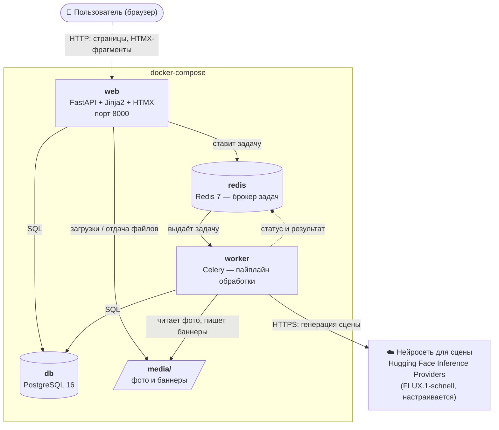
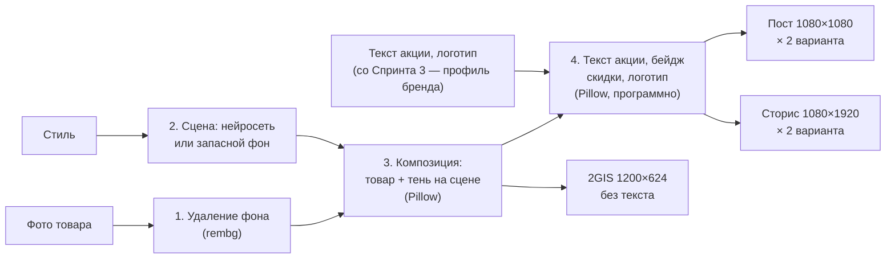
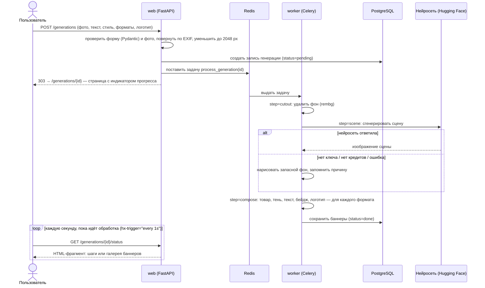
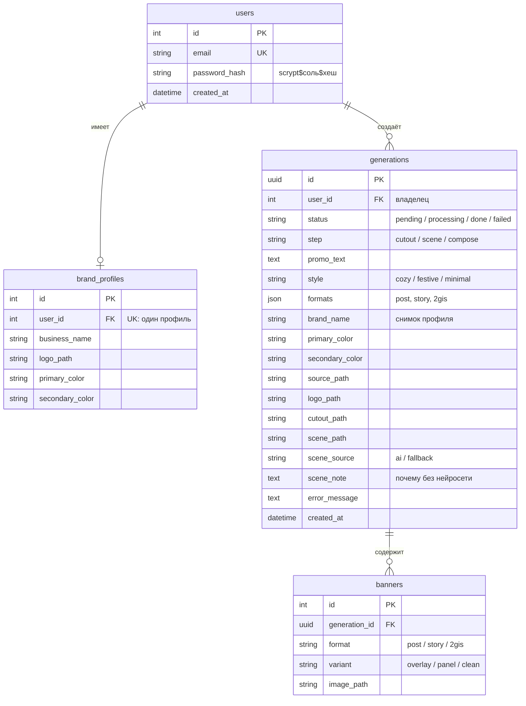

# Архитектура AdGen AI

> Документ для отчётов по дисциплине «Управление проектами».
> Актуален на конец **Спринта 3** (MVP готов). Обновляется в конце каждого спринта.
> Диаграммы написаны на Mermaid: GitHub показывает их как картинки. Для вставки в отчёт
> откройте файл на GitHub или в [mermaid.live](https://mermaid.live) и экспортируйте PNG/SVG.

## 1. Назначение системы

AdGen AI — веб-сервис для малого бизнеса (кафе, магазины, салоны). Пользователь загружает
фото товара, вводит текст акции, выбирает стиль и форматы — сервис возвращает готовые
рекламные баннеры: пост и сторис для соцсетей (по два варианта оформления) и фото для
блока «Скидки» в 2GIS.

## 2. Компоненты

Система состоит из четырёх контейнеров Docker и внешнего API нейросети.



| Компонент | Технология | Ответственность |
|-----------|------------|-----------------|
| **web** | FastAPI, Jinja2, HTMX, Tailwind CSS | HTML-страницы, приём загрузок, постановка задач, отдача статуса и файлов |
| **worker** | Celery | Долгая обработка изображений в фоне, чтобы веб-запрос не «висел» |
| **db** | PostgreSQL 16 | Пользователи, профили брендов, генерации и их результаты |
| **redis** | Redis 7 | Очередь задач Celery и хранение статусов/результатов задач |
| **media/** | локальная папка (позже — S3-совместимое хранилище) | Исходные фото, промежуточные и готовые изображения |
| **Нейросеть** | Hugging Face Inference Providers (модель и провайдер — в `.env`) | Генерация фоновой сцены по текстовому описанию. Если недоступна — запасной фон без нейросети |

`web` и `worker` собираются из **одного** Docker-образа и различаются только командой запуска —
код общий, поэтому задачи и модели не дублируются.

## 3. Пайплайн генерации баннера



**Почему текст накладывается программно, а не рисуется нейросетью.** Диффузионные модели
плохо генерируют текст: искажают буквы, особенно кириллицу, и путают цифры в ценах.
Для рекламы ошибка в цене недопустима, поэтому нейросеть рисует только фон, а текст и логотип
накладываются через Pillow — это точно и предсказуемо.

**Одна сцена на все форматы.** Нейросеть вызывается один раз за генерацию, сцена обрезается
под каждый формат. Так генерация в 3 раза дешевле, а баннеры разных форматов выглядят
единым комплектом.

## 4. Как проходит запрос (асинхронная генерация)

Обработка занимает от нескольких секунд до минуты, поэтому она выполняется в фоне, а страница
раз в секунду запрашивает статус через HTMX. Воркер записывает в базу текущий шаг
(`step`: `cutout` → `scene` → `compose`), и страница показывает, что сейчас происходит.



## 5. Модель данных

Таблицы добавляются постепенно, каждая — отдельной миграцией Alembic.

`generations.id` — UUID, а не порядковый номер: адреса страниц и файлов (`/generations/<id>`,
`/media/generations/<id>/...`) нельзя подобрать перебором. Страницы генерации доступны только
владельцу; сами файлы картинок защищены «неугадываемостью» адреса.
Файлы хранятся на диске, в базе — только относительные пути к ним.

**Снимок бренда.** При создании генерации название, цвета и логотип копируются из профиля
в генерацию. Если профиль потом поменяют, баннеры в истории останутся такими, какими были.



| Таблица | Спринт | Статус |
|---------|--------|--------|
| `users` | 0 | ✅ миграция `0001` |
| `generations` | 1–2 | ✅ миграция `0002`, поля параметров и сцены — миграция `0003` |
| `banners` | 2 | ✅ миграция `0003` |
| `brand_profiles` | 3 | ✅ миграция `0004` (там же — снимок бренда в `generations`) |

## 6. Структура проекта

```
ADGen_AI1/
├── app/                      # код приложения (общий для web и worker)
│   ├── main.py               # точка входа FastAPI: подключение роутеров и статики
│   ├── config.py             # настройки из .env (pydantic-settings)
│   ├── db.py                 # подключение к PostgreSQL, базовый класс моделей
│   ├── models.py             # модели SQLAlchemy: User, BrandProfile, Generation, Banner
│   ├── schemas.py            # Pydantic: проверка форм и ответы JSON API
│   ├── auth.py               # кто вошёл: сессия, зависимости CurrentUser / OptionalUser
│   ├── worker.py             # Celery-приложение
│   ├── tasks.py              # фоновые задачи Celery (пайплайн process_generation)
│   ├── templating.py         # общий объект Jinja2-шаблонов
│   ├── routers/              # обработчики URL
│   │   ├── pages.py          #   лендинг
│   │   ├── auth.py           #   регистрация, вход, выход
│   │   ├── account.py        #   профиль бренда, история
│   │   ├── generations.py    #   форма, страница результата, статус для HTMX, ZIP
│   │   └── api.py            #   JSON: /api/hello, /health, /api/generations/{id}
│   ├── services/             # бизнес-логика, не зависящая от HTTP
│   │   ├── presets.py        #   справочники: стили, форматы, варианты оформления
│   │   ├── images.py         #   проверка и подготовка фото и логотипа
│   │   ├── background.py     #   шаг 1: удаление фона (rembg)
│   │   ├── scene.py          #   шаг 2: сцена — нейросеть или запасной фон
│   │   ├── huggingface.py    #     вызов нейросети и понятные сообщения об ошибках
│   │   ├── fallback_scene.py #     запасной фон, нарисованный программно
│   │   ├── compose.py        #   шаг 3: товар с тенью на сцене, логотип
│   │   ├── text.py           #   шаг 4: текст акции, бейдж скидки, типографика
│   │   ├── banner.py         #   сборка баннера по раскладке формата
│   │   ├── passwords.py      #   хеширование паролей (scrypt)
│   │   ├── storage.py        #   сохранение файлов в media/
│   │   └── health.py         #   проверка БД, Redis, Celery
│   ├── assets/fonts/         # шрифт Montserrat (лицензия OFL)
│   ├── templates/            # Jinja2-шаблоны (base.html, страницы, partials/)
│   └── static/               # статика: иконка, js/upload.js (форма), img/ (пример на лендинге)
├── alembic/versions/         # миграции базы данных по порядку
├── tests/                    # pytest
├── docs/ARCHITECTURE.md      # этот документ
├── docs/DEPLOY.md            # запуск на сервере
├── .github/workflows/ci.yml  # CI: линтер и тесты на каждый push
├── CLAUDE.md                 # правила проекта для ИИ-ассистента
├── media/                    # загруженные и сгенерированные файлы (не в git)
├── Dockerfile                # образ для web и worker
├── docker-compose.yml        # web, worker, db, redis — разработка
├── docker-compose.prod.yml   # то же для сервера
├── requirements*.txt         # зависимости Python
├── pyproject.toml            # настройки ruff и pytest
└── .env.example              # шаблон переменных окружения (сам .env не в git)
```

Каждый шаг пайплайна — отдельный модуль в `app/services/`. Их можно тестировать по
отдельности, без веб-сервера и очереди.

## 7. Технологические решения

| Решение | Почему так |
|---------|------------|
| **FastAPI** | Современный, быстрый, автоматическая документация API (`/docs`), валидация через Pydantic |
| **Jinja2 + HTMX** вместо React/Vue | Весь проект на Python, нет отдельной сборки фронтенда. HTMX даёт динамику (прогресс, подгрузка галереи) атрибутами в HTML |
| **Tailwind CSS через CDN** | Аккуратный адаптивный дизайн без сборки CSS. Для продакшена можно перейти на сборку через Tailwind CLI |
| **Celery + Redis** | Генерация долгая (до минуты) — её нельзя делать внутри HTTP-запроса. Очередь также ограничивает нагрузку на API нейросети |
| **PostgreSQL + SQLAlchemy 2 + Alembic** | Надёжная реляционная БД; миграции фиксируют изменения схемы в git, их легко применить у напарника |
| **Синхронный SQLAlchemy** | Проще в понимании и отладке; FastAPI сам выполняет синхронные обработчики в пуле потоков |
| **Файлы в `media/`** | Просто для MVP; модуль `storage.py` позволит заменить на S3-совместимое хранилище |
| **Docker Compose** | Одна команда поднимает всё окружение одинаково на Windows, macOS и Linux |
| **Секреты только в `.env`** | Пароли и ключи не попадают в git; в репозитории — только шаблон `.env.example` |
| **rembg, модель `isnet-general-use`** | Работает локально и бесплатно, без внешнего API. Эта модель точнее стандартной `u2net` на фото предметов |
| **Модель rembg встроена в Docker-образ** | Скачивается при сборке (~180 МБ), поэтому первая обработка не ждёт загрузку модели |
| **Нейросеть для сцены настраивается** | `IMAGE_PROVIDER`, `HF_PROVIDER`, `HF_MODEL` в `.env` — модель и провайдера можно сменить без правки кода (раздел 9) |
| **Запасной фон без нейросети** | Сервис работает всегда: без ключа, без кредитов, без интернета. Причина показывается пользователю |
| **Текст рисуем сами, шрифт в репозитории** | Montserrat поддерживает кириллицу, казахские буквы и знак ₸; не зависим от шрифтов на компьютере |
| **Раскладка баннеров — данные, а не код** | Положение товара, текста, логотипа и бейджа задано долями размера в таблице `LAYOUTS` (`banner.py`) — новый формат добавляется строкой |
| **Проверка формы через Pydantic** | Правила (длина текста, стиль, форматы) в одном месте — `schemas.BannerRequest`; сообщения по-русски |
| **Сессия в подписанной cookie** (Starlette `SessionMiddleware`) | Проще JWT: не нужно хранить сессии на сервере, подделать cookie нельзя без `SECRET_KEY` |
| **Пароли — scrypt из стандартной библиотеки** | Медленный и «тяжёлый» по памяти алгоритм, рекомендуемый OWASP; без лишних зависимостей |
| **CI в GitHub Actions** | Линтер, форматирование и тесты на каждый push — ошибка видна сразу, а не на защите |
| **Отдельный compose для сервера** | Разработке удобны автоперезагрузка и монтирование кода, серверу — стабильность и безопасность ([DEPLOY.md](DEPLOY.md)) |
| **Тесты на SQLite в памяти** | Тесты не требуют запущенных PostgreSQL и Redis: быстро и подходит для CI. Нейросеть заменяется локальным тестовым сервером (раздел 9) |

## 8. Удаление фона: как устроено и почему так

1. **Проверка в веб-запросе** (`services/images.py`) — сразу, чтобы пользователь увидел ошибку
   на той же странице:
   - файл должен открываться как изображение: проверяется содержимое, а не расширение;
   - допустимые форматы: JPEG, PNG, WebP и MPO (так сохраняют фото многие телефоны и камеры;
     без этого снимки с телефона отклонялись — нашли при тестировании на реальном фото);
   - не больше 10 МБ (`MAX_UPLOAD_MB`), не меньше 200 px по стороне.
2. **Подготовка**: поворот по EXIF (телефоны хранят фото «на боку» с пометкой о повороте),
   уменьшение до 2048 px (для баннера 1080 px больше не нужно, а обработка быстрее),
   прозрачность заменяется белым фоном. Исходник сохраняется в JPEG.
3. **В воркере** (`services/background.py`): rembg строит маску товара, `post_process_mask`
   убирает «мусор» вне товара, затем края маски сужаются на 1 px и слегка размываются.

**Как выбирали обработку краёв.** Сравнили 5 вариантов на двух фото:

| Вариант | Результат | Время (фото 2048 px, замер в Docker) |
|---|---|---|
| Маска как есть | Мусорные пятна вне объекта | 1,1 с |
| `post_process_mask` | Чисто, но тёмная кайма по контуру и «лесенка» | 2,3 с |
| `alpha_matting` | Мягкие края, но размывает контур и очень медленно | 8,4 с |
| **`post_process_mask` + сужение на 1 px + размытие 1 px** | **Чистый контур без каймы** | **2,4 с** |
| то же, сужение на 2 px | Края слишком мягкие | 2,5 с |

**Ресурсы.** Каждый процесс воркера держит модель в памяти (~0,9 ГБ). Воркер запущен
с `--concurrency=2` (две обработки одновременно): ~1,8 ГБ памяти.

## 9. Сцена: нейросеть и запасной фон

**Как работает** (`services/scene.py`):

1. `IMAGE_PROVIDER=fallback` → сразу запасной фон (например, для демонстрации без интернета).
2. Нет ключа `HF_TOKEN` → запасной фон, причина «не указан ключ».
3. Иначе вызываем нейросеть через библиотеку `huggingface_hub` (`services/huggingface.py`).
   Любая ошибка превращается в понятную причину и запасной фон — генерация баннеров не падает.

| Ответ Hugging Face | Что видит пользователь (жёлтая плашка на странице результата) |
|---|---|
| 401 / 403 | Hugging Face не принял ключ — проверьте HF_TOKEN и галочку «Make calls to Inference Providers» |
| 402 | на аккаунте Hugging Face закончились кредиты на генерацию |
| 429 | Hugging Face просит подождать — слишком много запросов |
| 5xx | сервис нейросети временно недоступен |
| таймаут (90 с) | нейросеть не ответила вовремя |
| нет сети | нет связи с Hugging Face |

**Почему такие настройки по умолчанию.** Перед реализацией провели исследование
(11.10.2026) с перекрёстной проверкой выводов:

- **Модель `black-forest-labs/FLUX.1-schnell`, провайдер `nscale`.** Изначально планировали
  Stable Diffusion XL, но она, по данным документации Hugging Face, больше не обслуживается
  ни одним провайдером. FLUX.1-schnell — диффузионная модель того же класса от команды,
  создавшей Stable Diffusion: 4 шага генерации, открытая лицензия Apache-2.0, ~$0,0014 за
  картинку 1024×1024 (≈700 картинок на $1). Провайдер указан явно, а не `auto`: при `auto`
  выбор зависит от настроек аккаунта, и стоимость непредсказуема.
- **Вариант со Stable Diffusion:** `HF_PROVIDER=hf-inference`,
  `HF_MODEL=stabilityai/stable-diffusion-3-medium-diffusers` (модель с ограниченным доступом:
  сначала нужно принять лицензию на странице модели тем же аккаунтом).
- **Кредиты.** По документации Hugging Face, с октября 2026 бесплатные аккаунты не получают
  ежемесячных кредитов на Inference Providers (раньше было $0,10). Для генерации сцен
  нейросетью нужно купить кредиты или оформить PRO ($2 кредитов в месяц). Без кредитов
  сервис работает на запасном фоне и честно пишет об этом.
- **Передаём только описание сцены и размер.** Разные провайдеры понимают разный набор
  параметров; `negative_prompt` и `seed` не все поддерживают, и лишний параметр может привести
  к отказу. Поэтому описание сцены сразу формулируется как пустая сцена («nothing on the table»).
- **Ключ называется `HF_TOKEN`.** Перед генерацией библиотека сама делает служебный запрос
  к Hugging Face и берёт ключ именно из переменной `HF_TOKEN`.
- **Особенность библиотеки:** в `huggingface_hub` 2.2 таймаут приходит как ошибка `httpx2`,
  а не как `InferenceTimeoutError` из документации, — обрабатываем оба варианта.

**Как проверено.** Из среды разработки Hugging Face недоступен (сетевые ограничения),
поэтому код проверен **настоящей библиотекой** против локального тестового сервера, который
отвечает как сервис генерации: картинкой, кодами 401/402/403/429/500 и задержкой
(`tests/test_scene.py`). Реальный вызов с ключом нужно проверить на своём компьютере.

**Запасной фон** (`services/fallback_scene.py`) рисуется Pillow: градиент «стены»,
«стол» внизу кадра и декор по стилю (боке-огоньки, конфетти). Фон повторяемый: зависит
от идентификатора генерации.

## 10. Форматы баннеров и почему 2GIS — без текста

| Формат | Размер | Варианты | Что учтено |
|---|---|---|---|
| Пост | 1080×1080 | «Текст на фоне», «Текст на плашке» | — |
| Сторис | 1080×1920 | «Текст на фоне», «Текст на плашке» | Верхние и нижние ~13% экрана закрывает интерфейс Instagram — текст, логотип и товар между ними |
| 2GIS | 1200×624 | «Без текста» | Фото для блока «Скидки» в карточке компании |

**2GIS.** Исследование требований 2GIS (11.10.2026, по выдержкам со страницы
[reklama.2gis.ru/advertising-spec](https://reklama.2gis.ru/advertising-spec); сами страницы 2GIS
из среды разработки недоступны — перед защитой стоит открыть и сверить):

- единого размера «баннера 2GIS» нет: реклама в 2GIS собирается из шаблонов — пользователь
  загружает фото и логотип, а текст вводит в отдельные поля;
- для объявления об акции подходит блок **«Скидки»** в карточке компании: изображение
  **не меньше 600×312**, до 5 МБ, **без логотипов и текста**; заголовок — до 45 символов,
  описание — до 400;
- поэтому для 2GIS делаем фото **1200×624** (вдвое больше минимума, та же пропорция 25:13),
  товар по центру с полями (устройства обрезают картинку по-разному), без текста. На странице
  результата подсказываем вставить текст акции в поле «Заголовок» и предупреждаем,
  если он длиннее 45 символов;
- баннер с «впечатанным» текстом модерация 2GIS, скорее всего, отклонила бы;
- для Казахстана 2GIS требует текст рекламы на казахском и русском — это относится к полям
  карточки, которые заполняет пользователь.

**Сборка баннера** (`services/banner.py`, `text.py`, `compose.py`):

- сцена растягивается на весь баннер и слегка размывается — эффект глубины резкости;
- товар обрезается по контуру, вписывается в свою область и «ставится» на её нижнюю
  границу; тень из двух слоёв: контактная (эллипс под основанием) и мягкий ореол;
- под текстом — плавное затемнение (вариант «на фоне») или цветная плашка (вариант
  «на плашке»); цвет текста выбирается по яркости фона, чтобы текст всегда читался;
- размер шрифта подбирается автоматически: самый крупный, при котором текст влезает;
- русская типографика: предлоги не остаются в конце строки («в·подарок»), число
  не отрывается от валюты («990·₸»), тире не начинает строку;
- скидка в процентах («20%», «-15 %») находится в тексте и выносится в круглый бейдж «−20%».

## 11. Безопасность

| Угроза | Защита |
|---|---|
| Утечка базы → пароли | В базе только хеш scrypt с солью; сравнение за постоянное время (`hmac.compare_digest`) |
| Подделка сессии | Cookie подписана `SECRET_KEY`; на сервере нельзя запуститься с ключом-заглушкой `change-me` |
| Кража cookie скриптом | Cookie `httponly` — JavaScript её не читает; на HTTPS — флаг `secure` (`COOKIE_SECURE=true`) |
| CSRF (чужой сайт отправляет форму от имени пользователя) | Cookie `SameSite=Lax` — браузер не прикладывает её к POST с чужого сайта; выход — только POST |
| Чужие генерации | Страницы, статус, ZIP и API отдают генерацию только владельцу (иначе 404) |
| Перебор email | Одно сообщение «Неверный email или пароль» для обоих случаев |
| Открытый редирект после входа | `next` принимается только как внутренний адрес (`/...`, не `//...`) |
| XSS | Jinja2 экранирует весь вывод (проверено на `<script>` в тексте акции) |
| «Картинки-бомбы», подмена файлов | Проверка формата по содержимому, лимиты размера в МБ и в пикселях до раскодирования |
| Права в контейнере | На сервере приложение работает от пользователя `app`, не root |

Осознанно не сделано в MVP: подтверждение email, восстановление пароля, ограничение частоты
попыток входа — описаны в [DEPLOY.md](DEPLOY.md) как следующие шаги.

## 12. Окружение и порты

| Сервис | Адрес с компьютера | Адрес внутри Docker |
|--------|-------------------|---------------------|
| web | http://localhost:8000 | `web:8000` |
| db | `localhost:5433` (для DBeaver/pgAdmin) | `db:5432` |
| redis | — (наружу не открыт) | `redis:6379` |

## 13. План по спринтам

| Спринт | Содержание | Статус |
|--------|------------|--------|
| 0 | Структура проекта, docker-compose, FastAPI «hello», база + первая миграция, базовый шаблон с Tailwind, README, этот документ | ✅ готово |
| 1 | Загрузка фото + удаление фона (rembg) в задаче Celery, показ результата (без авторизации) | ✅ готово |
| 2 | Генерация сцены, композиция, текст, логотип, форматы, галерея и скачивание | ✅ готово |
| 3 | Регистрация, профиль бренда, история, лендинг, тесты, CI (GitHub Actions), подготовка к деплою | ✅ готово |

## 14. Что сделано

### Спринт 0

- Docker-окружение из 4 сервисов: `web`, `worker`, `db`, `redis` (с проверками готовности).
- FastAPI-приложение: главная страница, `GET /api/hello`, `GET /health`, документация `/docs`.
- Подключение к PostgreSQL, первая миграция Alembic (таблица `users`), применяется автоматически
  при старте `web`.
- Celery-воркер с тестовой задачей `ping`.
- Базовый шаблон: Tailwind CSS, HTMX, адаптивная вёрстка; на главной — блок «Состояние системы»,
  который через HTMX показывает, работают ли база, Redis и воркер.
- Тесты (pytest) и линтер (ruff).

### Спринт 1

- Страница «Новый баннер» (`/create`): загрузка фото перетаскиванием или выбором файла,
  предпросмотр, проверка формата и размера ещё в браузере.
- Проверка и подготовка фото на сервере: формат по содержимому, размер, поворот по EXIF,
  уменьшение до 2048 px.
- Таблица `generations` (миграция `0002`), идентификаторы — UUID.
- Задача Celery `process_generation`: удаление фона rembg (`isnet-general-use`) со сглаживанием
  краёв; статусы `pending → processing → done / failed`.
- Страница результата: прогресс обновляется через HTMX каждую секунду, затем «было / стало»
  и скачивание PNG без фона. При ошибке — понятное сообщение.
- JSON API `GET /api/generations/{id}` (Pydantic-схема `GenerationOut`).
- 26 тестов: проверка фото, загрузка, задача, страницы, API, настоящая модель (`slow`).
- Найден и исправлен баг: фото с телефонов и камер в формате MPO отклонялись.

### Спринт 2

- Форма: фото, текст акции (до 120 символов, счётчик), стиль (уютный, праздничный,
  минимализм — карточки с превью), форматы, необязательный логотип. Проверка — Pydantic.
- Пайплайн в задаче Celery: удаление фона → сцена → баннеры; текущий шаг виден на странице.
- Сцена нейросетью через Hugging Face (FLUX.1-schnell, настраивается) и запасной фон без
  нейросети с понятной причиной.
- Композиция с тенью, текст с автоподбором размера и русской типографикой, бейдж скидки,
  логотип (без прозрачности — на белой плашке).
- Форматы: пост и сторис по 2 варианта, фото для блока «Скидки» 2GIS без текста.
- Галерея результатов: скачивание каждого баннера, всех сразу (ZIP), товара без фона.
- Таблица `banners` и новые поля генерации (миграция `0003`).
- Исследования с перекрёстной проверкой: требования 2GIS к изображениям, актуальный API
  и стоимость генерации Hugging Face.
- Найдено и исправлено при проверке на неудобных данных: эмодзи рисовались пустыми
  квадратиками (в шрифте их нет — теперь отбрасываются); очень длинное слово вылезало за
  плашку (теперь режется, если не помещается даже мелким шрифтом); «картинка-бомба»
  (PNG в 17 КБ размером 12000×12000) раскодировалась и съедала память (теперь лимит
  60 Мп проверяется до раскодирования). Текст акции в HTML экранируется — XSS нет.
- 76 тестов, включая вызов настоящей библиотеки `huggingface_hub` против локального
  тестового сервера.

### Спринт 3

- Регистрация, вход и выход: пароли — scrypt, сессия — подписанная cookie; страницы создания,
  профиля и истории — только для вошедших (с возвратом на нужную страницу после входа).
- Профиль бренда: название, логотип, два цвета. Основной цвет — плашка с текстом, второй —
  бейдж скидки; без логотипа на баннере плашка с названием бизнеса. Снимок бренда хранится
  в генерации (миграция `0004`).
- Генерации привязаны к пользователю; чужие недоступны (404).
- История генераций с превью и статусом.
- Лендинг: настоящий пример «было → стало», шаги, преимущества, вопросы.
- CI в GitHub Actions: ruff и pytest на каждый push (проверено в чистом контейнере Python 3.12).
- Подготовка к деплою: `docker-compose.prod.yml` (без dev-зависимостей, 2 процесса,
  автоперезапуск, контейнеры не от root, база закрыта), [DEPLOY.md](DEPLOY.md) с HTTPS через
  Caddy и резервным копированием; проверено запуском prod-стека.
- `CLAUDE.md` — правила проекта для работы с ИИ-ассистентом в новых сессиях.
- 93 теста: регистрация и вход, подделка cookie, доступ к чужим генерациям, открытый редирект,
  профиль, история, бренд в баннерах.
