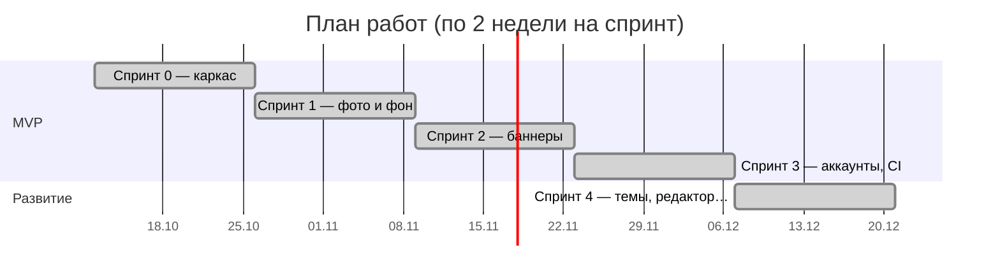
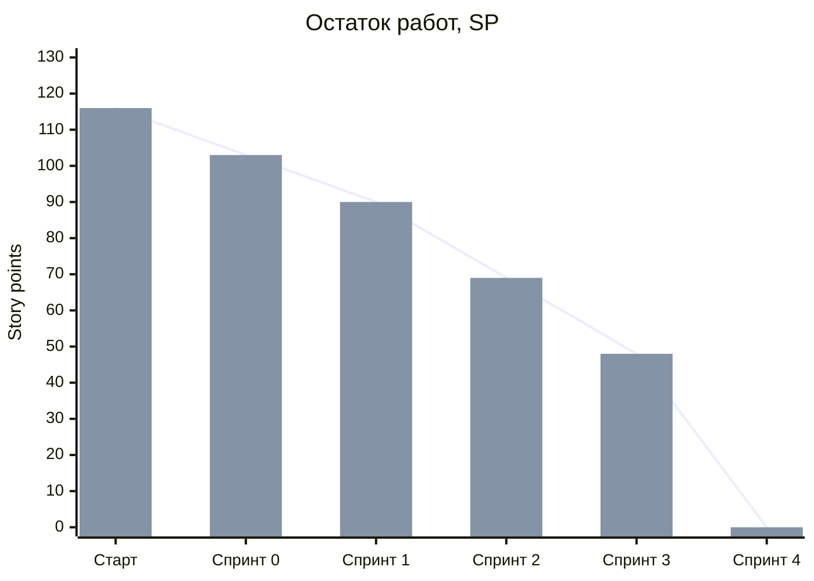

# Управление проектом AdGen AI

> Документ для отчёта по дисциплине «Управление проектами». Здесь — артефакты Scrum:
> паспорт проекта, бэклог продукта, план и итоги спринтов, диаграмма сгорания,
> ретроспективы, реестр рисков и журнал изменений объёма.
> Архитектура и технические решения — в [ARCHITECTURE.md](ARCHITECTURE.md).
>
> ⚠️ Распределение ролей и плановые даты ниже — предложение. Поправьте под то, как
> вы на самом деле договорились в команде и с преподавателем.

## 1. Паспорт проекта

| | |
|---|---|
| **Название** | AdGen AI — генератор рекламных баннеров для малого бизнеса |
| **Проблема** | Кафе, магазины и салоны регулярно делают акции, но у них нет дизайнера: баннеры получаются кустарными или стоят дорого и долго |
| **Решение** | Веб-сервис: фото товара + текст акции + пожелание к дизайну → несколько готовых вариантов для Instagram (пост, сторис, карусель, видео) и 2GIS за минуту |
| **Целевая аудитория** | Владельцы и SMM-менеджеры малого бизнеса в Казахстане |
| **Ценность** | Экономия денег и времени; единый фирменный стиль; учёт местной специфики (казахский текст, ₸, 2GIS, праздники РК) |
| **Команда** | Куантканов Думан, Кайролла Диас (группа ТИИ-44) |
| **Срок MVP** | Начало декабря 2026 |
| **Методология** | Scrum, спринты по 2 недели |
| **Ограничения** | Бюджет 0 ₸ (никаких платных сервисов); 2 человека; учебный семестр |

### Роли

| Роль | Кто | Ответственность |
|---|---|---|
| Product Owner | Куантканов Думан | Бэклог, приоритеты, приёмка историй, демо |
| Scrum Master | Кайролла Диас | Планирование и ретроспективы, снятие блокеров, сроки |
| Команда разработки | Оба + ИИ-ассистент (Claude) | Код, тесты, документация. ИИ пишет код по задачам команды; команда ставит задачи, проверяет и принимает результат |

### Определение готовности (Definition of Done)

История считается готовой, если:

1. Код в репозитории, коммит с понятным сообщением.
2. Линтер `ruff` без замечаний, все тесты `pytest` зелёные, CI в GitHub Actions зелёный.
3. Изменения базы — через миграцию Alembic, проверены откат и повторное применение.
4. Функция проверена в браузере на компьютере и на ширине телефона (390 px).
5. README (чек-лист проверки) и ARCHITECTURE.md обновлены.

## 2. Бэклог продукта

Приоритеты по MoSCoW: **M** — must (обязательно для MVP), **S** — should, **C** — could.
Оценка — story points (SP, относительная сложность по шкале Фибоначчи).

| № | Пользовательская история | Приор. | SP | Спринт | Статус |
|---|---|---|---|---|---|
| 1 | Как команда, мы хотим каркас проекта и Docker, чтобы одинаково запускать его на любом компьютере | M | 5 | 0 | ✅ |
| 2 | Как команда, мы хотим базу данных с миграциями, чтобы схема менялась без потери данных | M | 3 | 0 | ✅ |
| 3 | Как команда, мы хотим документацию запуска и архитектуры, чтобы напарник и преподаватель разобрались | M | 5 | 0 | ✅ |
| 4 | Как владелец кафе, я хочу загрузить фото товара перетаскиванием, чтобы не возиться с формами | M | 3 | 1 | ✅ |
| 5 | Как владелец кафе, я хочу, чтобы фон с фото удалялся автоматически, чтобы товар смотрелся профессионально | M | 5 | 1 | ✅ |
| 6 | Как пользователь, я хочу видеть прогресс обработки, чтобы понимать, что сервис работает | M | 5 | 1 | ✅ |
| 7 | Как владелец кафе, я хочу ввести текст акции и получить баннеры, где текст без ошибок | M | 5 | 2 | ✅ |
| 8 | Как SMM-менеджер, я хочу форматы поста, сторис и 2GIS, чтобы не подгонять размеры вручную | M | 5 | 2 | ✅ |
| 9 | Как пользователь, я хочу скачать каждый баннер и все сразу (ZIP) | M | 3 | 2 | ✅ |
| 10 | Как пользователь, я хочу, чтобы сцену рисовала нейросеть, а при её недоступности сервис не ломался | S | 8 | 2 | ✅ (позже — необязательный вариант) |
| 11 | Как пользователь, я хочу регистрироваться и входить, чтобы мои баннеры были только моими | M | 5 | 3 | ✅ |
| 12 | Как владелец бизнеса, я хочу один раз указать логотип и фирменные цвета, чтобы они были на всех баннерах | M | 5 | 3 | ✅ |
| 13 | Как пользователь, я хочу историю генераций, чтобы скачать старые баннеры снова | M | 3 | 3 | ✅ |
| 14 | Как посетитель, я хочу понятную главную страницу с примером «было → стало» | S | 3 | 3 | ✅ |
| 15 | Как команда, мы хотим CI и инструкцию деплоя, чтобы проверка и запуск на сервере были автоматическими | S | 5 | 3 | ✅ |
| 16 | Как пользователь, я хочу стильные дизайн-темы вместо простого фона | S | 8 | 4 | ✅ |
| 17 | Как пользователь, я хочу описать словами, какой баннер хочу, и получить 4 варианта | S | 8 | 4 | ✅ |
| 18 | Как пользователь, я хочу указать цену (старую и новую), срок и кнопку-призыв | S | 5 | 4 | ✅ |
| 19 | Как кафе, я хочу QR-код на баннере со ссылкой на меню или WhatsApp | C | 2 | 4 | ✅ |
| 20 | Как бизнес в Казахстане, я хочу казахский текст на баннере по требованиям закона о рекламе | S | 3 | 4 | ✅ |
| 21 | Как пользователь, я хочу «ещё варианты», «другие цвета» и правку без новой загрузки фото | S | 5 | 4 | ✅ |
| 22 | Как пользователь, я хочу отмечать понравившиеся варианты, чтобы сервис предлагал похожее | C | 2 | 4 | ✅ |
| 23 | Как SMM-менеджер, я хочу поделиться вариантами с заказчиком по ссылке без регистрации | C | 2 | 4 | ✅ |
| 24 | Как SMM-менеджер, я хочу карусель Instagram и видео-сторис | C | 5 | 4 | ✅ |
| 25 | Как пользователь, я хочу подсказки к праздникам (Наурыз, 8 марта) и готовые тексты акций | C | 2 | 4 | ✅ |
| 26 | Как владелец сервиса, я хочу тарифы с лимитом, чтобы показать модель монетизации | C | 3 | 4 | ✅ |
| 27 | Как администратор, я хочу статистику использования, чтобы принимать решения по продукту | C | 3 | 4 | ✅ |
| 28 | Как пользователь, я хочу подтверждение email и восстановление пароля | C | 5 | — | Отложено (нужна почтовая служба) |
| 29 | Как пользователь, я хочу настоящую оплату Pro | C | 8 | — | Отложено (нужен договор с платёжной системой) |
| 30 | Как команда, мы хотим публичный сервер с доменом | C | 5 | — | Отложено (платный хостинг, бюджет 0 ₸) |

## 3. Спринты

| Спринт | План (2 недели) | Факт (по git) | Цель спринта | SP план / факт |
|---|---|---|---|---|
| 0 | 12.10 – 25.10 | 11.10 | Каркас: Docker, FastAPI, база, документация | 13 / 13 |
| 1 | 26.10 – 08.11 | 11.10 | Загрузка фото и удаление фона в фоне (Celery) | 13 / 13 |
| 2 | 09.11 – 22.11 | 12.10 | Сцена, композиция, текст, форматы, галерея | 21 / 21 |
| 3 | 23.11 – 06.12 | 12.10 | Аккаунты, профиль бренда, история, лендинг, CI, деплой → **MVP** | 21 / 21 |
| 4 | после MVP | 05.11 – 07.11 | Развитие продукта: дизайн-темы, пожелание, редактор, карусель, видео, тарифы, статистика | 48 / 48 |

Фактически спринты 0–3 выполнены быстрее плана: код писал ИИ-ассистент по задачам команды,
а время команды ушло на постановку задач, проверку и приёмку. Освободившееся время
использовано на Спринт 4 — развитие продукта сверх MVP.

### Диаграмма сгорания релиза (burndown)

Сколько story points оставалось в бэклоге (истории 1–27, всего 116 SP) после каждого спринта:

### Итоги спринтов

**Спринт 0 — каркас.** Docker из 4 сервисов (web, worker, db, redis), FastAPI, первая миграция,
шаблон на Tailwind и HTMX, README и ARCHITECTURE.md. *Демо:* страница «Состояние системы»,
где все три компонента зелёные.

**Спринт 1 — фото и удаление фона.** Загрузка перетаскиванием, проверка файла, удаление фона
нейросетью rembg в фоновой задаче Celery, прогресс через HTMX. *Демо:* «было → стало».

**Спринт 2 — баннеры.** Сцена (нейросеть Hugging Face или запасной фон), композиция с тенью,
текст с автоподбором размера и русской типографикой, форматы, ZIP. *Демо:* галерея баннеров.

**Спринт 3 — MVP.** Регистрация и вход, профиль бренда, история, лендинг, CI, инструкция деплоя.
*Демо:* полный путь пользователя от регистрации до скачивания.

**Спринт 4 — развитие.** 8 дизайн-тем, пожелание к дизайну (4 варианта), цена и QR-код,
казахский текст, редактор вариантов, избранное, ссылка «поделиться», карусель, видео-сторис,
календарь праздников, тарифы, статистика. *Демо:* один запрос — разные варианты, правка без
повторной загрузки, видео-сторис.

## 4. Ретроспективы

| Спринт | Что получилось хорошо | Что мешало | Что меняем |
|---|---|---|---|
| 0 | Всё запускается одной командой; документация с самого начала | Не знали ОС напарника | Команды в README для Windows и macOS |
| 1 | Тест на реальном фото нашёл баг: снимки телефонов (формат MPO) отклонялись | Тёмная кайма вокруг вырезанного товара | Сравнивать настройки на реальных фото и выбирать по картинкам, а не наугад (выбрано из 5 вариантов) |
| 2 | Исследование заранее: выяснили, что 2GIS запрещает текст на фото, а SDXL больше не обслуживается | Hugging Face недоступен из среды разработки; бесплатные кредиты отменили | Внешние сервисы — только с запасным вариантом; проверять API через локальный тестовый сервер |
| 3 | CI ловит ошибки до защиты; проверка безопасности (подделка cookie, чужие генерации, XSS) | Ключ API отправили в чат — пришлось перевыпускать | Секреты — только в `.env`, правило записано в CLAUDE.md |
| 4 | Прототип показали до встраивания — выбор делали по картинкам | Программный фон выглядел дёшево — недовольство заказчика (команды) | Чаще показывать промежуточный результат; дизайн-решения принимать по превью |

## 5. Реестр рисков

Вероятность и влияние: Н — низкие, С — средние, В — высокие.

| Риск | Вер. | Влияние | Реакция | Статус |
|---|---|---|---|---|
| Внешняя нейросеть недоступна или платная | В | В | Работа без неё: дизайн-темы рисуем сами, сцена — необязательный вариант | Сработал (кредиты HF отменены) — последствия сняты |
| Нейросеть искажает текст и цены | В | В | Текст никогда не рисует нейросеть — только наш код со шрифтом | Предотвращён |
| Требования 2GIS к изображениям | С | С | Исследование требований; фото для 2GIS без текста | Снят; перед защитой сверить на сайте 2GIS |
| Слабый компьютер не тянет нейросеть удаления фона | С | С | Модель встроена в образ; `--concurrency=1` при нехватке памяти (README) | Под контролем |
| Утечка секретов (ключи, пароли) | С | В | `.env` вне git, `.env.example` в репозитории, правило в CLAUDE.md | Был инцидент с ключом в чате — ключ перевыпущен |
| Не успеть к сроку MVP | Н | В | Короткие спринты, приоритеты MoSCoW, MVP-объём закрыт первым | Снят |
| Демо на защите сорвётся (нет интернета, не запустился Docker) | С | В | Работа без интернета (кроме CDN стилей); прогон накануне; видео-запись демо как запасной план | Открыт — подготовить запись |
| Кто-то из команды не сможет объяснить код | С | В | Простой код, комментарии на русском, ARCHITECTURE.md с причинами решений | Открыт — репетиция защиты |

## 6. Журнал изменений объёма (change log)

| Дата | Изменение | Причина | Решение |
|---|---|---|---|
| 12.10 | Модель сцены SDXL → FLUX.1-schnell | SDXL больше не обслуживается провайдерами Hugging Face | Модель настраивается в `.env` |
| 12.10 | «Баннер 2GIS» → фото для блока «Скидки» без текста | Требование 2GIS: на фото нельзя размещать текст и логотипы | Текст пользователь вводит в поле карточки 2GIS |
| 12.10 | Логотип перенесён из формы в профиль бренда | Логотип постоянный — неудобно загружать каждый раз | Профиль бренда (Спринт 3) |
| 05.11 | «Товар на нарисованном фоне» → дизайн-темы | Без платной нейросети фон выглядел дёшево | 8 тем + сцена нейросетью как необязательный вариант |
| 05.11 | Пожелание к дизайну — по ключевым словам, а не языковой моделью | Бюджет 0 ₸ | Логика объяснима; можно заменить моделью позже |
| 07.11 | Добавлены истории 18–27 | Освободилось время после MVP | Спринт 4 |

## 7. Метрики

**Качество:** 161 автотест (pytest), линтер ruff, CI на каждый push; миграции проверяются
откатом. Покрытие кода тестами отдельно не измеряли.

**Продукт** (страница `/admin`): пользователи и Pro, генерации по дням, среднее время
генерации, доля ошибок, популярные темы, форматы и настроения, избранное, ссылки «поделиться».
Эти метрики помогают решать, что развивать дальше: например, популярные темы — улучшать,
непопулярные — пересматривать.
