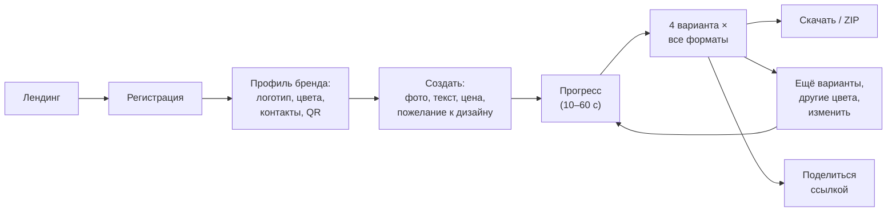
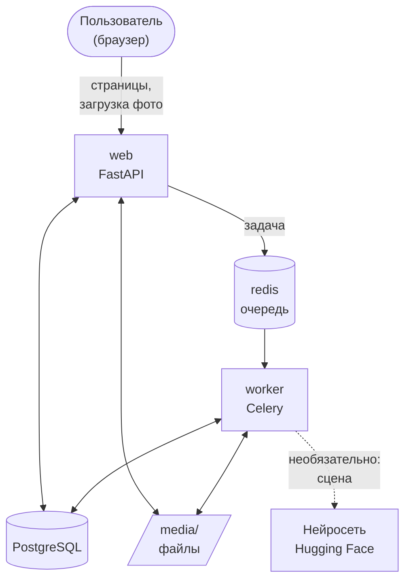

# AdGen AI — полное описание проекта

> Материал для отчётов и презентаций: что за продукт, из чего он состоит, как работает,
> почему сделан именно так, цифры, готовый план презентации и ответы на вопросы защиты.
> Подробности: архитектура — [ARCHITECTURE.md](ARCHITECTURE.md), управление проектом
> (бэклог, спринты, риски) — [PROJECT_MANAGEMENT.md](PROJECT_MANAGEMENT.md), запуск — [SETUP_WINDOWS.md](SETUP_WINDOWS.md).

---

## 1. Коротко (для первого слайда и аннотации)

**AdGen AI** — веб-сервис, который за минуту делает рекламные баннеры для малого бизнеса.
Владелец кафе, магазина или салона загружает фото товара с телефона, пишет текст акции
и описывает словами, какой дизайн хочет («уютно, по-осеннему»). Сервис сам удаляет фон
с фото нейросетью и предлагает 4 варианта дизайна — сразу в форматах для Instagram
(пост, сторис, карусель, видео) и 2GIS, с логотипом, фирменными цветами, ценой и QR-кодом.

**Команда:** Куантканов Думан, Кайролла Диас (группа ТИИ-44). **Дисциплина:** «Управление проектами».

---

## 2. Проблема, решение, аудитория

### Проблема
- Малому бизнесу постоянно нужна реклама: акции, новинки, праздники — каждую неделю.
- Дизайнер — дорого и долго (дни, тысячи тенге за макет). Самому — долго и выглядит кустарно.
- Универсальные редакторы (Canva и др.) требуют времени и навыков: нужно самому собрать макет.
- Генераторы картинок на нейросетях путают буквы и цифры: цена «1990 ₸» превращается в набор символов,
  а для рекламы ошибка в цене недопустима.

### Решение
Сервис, где пользователь вводит только **содержание** (фото, текст, цена), а **дизайн**
сервис делает сам: удаляет фон, подбирает тему, цвета и шрифты, раскладывает всё по форматам.

### Целевая аудитория
Владельцы и SMM-менеджеры малого бизнеса в Казахстане: кафе, пекарни, кофейни, магазины,
салоны красоты, цветочные, доставка еды.

### Ценность для пользователя
| Для кого | Ценность |
|---|---|
| Владелец бизнеса | Баннер за минуту вместо дней ожидания; бесплатно |
| SMM-менеджер | Сразу все форматы; варианты на выбор; ссылка для согласования с заказчиком |
| Бизнес в Казахстане | Казахский текст (закон о рекламе), цены в ₸, требования 2GIS, праздники РК |

### Чем отличаемся от альтернатив
| Альтернатива | Минус для малого бизнеса | Как у нас |
|---|---|---|
| Дизайнер / фрилансер | Дорого, долго | Минута, бесплатно |
| Canva | Нужно собирать макет самому | Описал словами — получил 4 готовых варианта |
| Генераторы картинок (ИИ) | Ошибки в тексте и ценах | Текст набирается шрифтом — без ошибок |
| Gamma и подобные | Платные, не про рекламу, не знают местную специфику | Бесплатно, под рекламу, ₸, казахский, 2GIS |

---

## 3. Возможности продукта

**Создание баннера**
- Загрузка фото перетаскиванием, проверка файла (формат, размер, «битые» файлы).
- Удаление фона с фото товара нейросетью.
- Текст акции; текст на казахском (на баннере — первым, как требует закон РК о рекламе).
- Новая цена крупно, старая — зачёркнутая; срок акции; кнопка-призыв («Закажите сейчас»).
- Пожелание к дизайну обычными словами: настроение, цвета, шрифт → 4 разных варианта.
- Готовые тексты акций и календарь праздников (Наурыз, 8 марта, Чёрная пятница…).

**Дизайн**
- 8 дизайн-тем: Яркий, Фото, Премиум, Минимализм, Журнал, Узор, Классика, Плакат.
- 4 шрифта, автоподбор размера текста, правила русской типографики.
- Логотип, фирменные цвета, контакты и QR-код из профиля бренда — на каждом баннере.

**Форматы**
| Формат | Размер | Особенность |
|---|---|---|
| Пост | 1080×1080 | — |
| Сторис | 1080×1920 | Текст вне зон, закрытых интерфейсом Instagram |
| Карусель | 4 слайда 1080×1350 | Обложка → товар → условия → контакты |
| Видео-сторис | MP4, 5 с | Плавное приближение и появление |
| 2GIS | 1200×624 | Без текста — требование 2GIS для блока «Скидки» |

**После генерации**
- «Ещё варианты», «Другие цвета», «Изменить» — без повторной загрузки фото.
- Избранное ★ — любимая тема потом предлагается первой.
- Скачать каждый баннер или все сразу (ZIP); ссылка «поделиться» без регистрации.
- История всех генераций.

**Аккаунт и бизнес**
- Регистрация и вход, профиль бренда.
- Тарифы: бесплатно 5 генераций в день, Pro — без ограничений (демо, без оплаты).
- Статистика для администратора: пользователи, генерации по дням, популярные темы, ошибки.

---

## 4. Путь пользователя (сценарий для демонстрации)

---

## 5. Из чего состоит система

### Компоненты
| Компонент | Что делает | Простыми словами |
|---|---|---|
| **web** (FastAPI) | Страницы сайта, приём фото, выдача результатов | «Витрина» — то, с чем общается пользователь |
| **worker** (Celery) | Тяжёлая обработка: удаление фона, сборка баннеров, видео | «Цех» — работает в фоне, чтобы сайт не зависал |
| **redis** | Очередь задач между web и worker | «Лента конвейера» — передаёт задания в цех |
| **db** (PostgreSQL) | Пользователи, профили, генерации, баннеры | «Картотека» |
| **media/** | Файлы: фото, баннеры, видео | «Склад готовой продукции» |

Все компоненты запускаются одной командой через **Docker Compose** — одинаково на Windows,
macOS и Linux.

### Как проходит генерация (пайплайн)
1. **Проверка** фото на сервере: настоящее ли изображение, размер, поворот по EXIF.
2. **Постановка в очередь** — пользователь сразу видит страницу с прогрессом.
3. **Удаление фона** нейросетью rembg (`isnet-general-use`) + сглаживание краёв.
4. **Понимание пожелания:** ключевые слова → настроение, цвета, шрифт → 4 дизайн-задания.
5. **Сборка баннеров:** каждая тема рисует баннер для каждого формата (Pillow).
6. **Карусель и видео** — по первому варианту.
7. **Сохранение** и показ галереи; страница обновляется сама каждую секунду (HTMX).

### Технологии и зачем они
| Технология | Зачем | Почему она |
|---|---|---|
| Python 3.12 | Весь серверный код | Один язык на всё; много библиотек для изображений |
| FastAPI | Веб-сервер, страницы, API | Современный, быстрый, автодокументация `/docs` |
| Jinja2 + HTMX | HTML-страницы и динамика (прогресс) | Не нужен отдельный фронтенд на React |
| Tailwind CSS | Дизайн сайта, адаптивность под телефон | Красиво без написания CSS вручную |
| PostgreSQL + SQLAlchemy | Хранение данных | Надёжная база, работа через Python-объекты |
| Alembic | Миграции базы | Изменения схемы фиксируются в git |
| Celery + Redis | Фоновые задачи | Долгая обработка не «вешает» сайт |
| Pillow | Рисование баннеров, текста, теней | Стандарт обработки изображений в Python |
| rembg | Удаление фона нейросетью | Работает локально и бесплатно |
| qrcode, PyAV | QR-коды, видео MP4 | Без внешних программ |
| Pydantic | Проверка данных форм | Правила в одном месте, понятные ошибки |
| pytest, ruff | Тесты, проверка стиля кода | Качество и единый стиль |
| GitHub Actions | CI — проверка на каждый push | Ошибки видны сразу |
| Docker Compose | Запуск всего одной командой | Одинаково у всех в команде |

### Модель данных
| Таблица | Что хранит |
|---|---|
| `users` | Email, хеш пароля, тариф (Pro) |
| `brand_profiles` | Название, логотип, 2 цвета, контакты, ссылка для QR |
| `generations` | Одна «заявка»: текст, пожелание, цены, формы, статус, как поняли пожелание, ссылка «поделиться» |
| `banners` | Готовые файлы: формат, вариант (тема), избранное |

---

## 6. Ключевые решения и их обоснование

Это главное, что стоит рассказать на защите: **почему** сделано так.

1. **Текст рисует программа, а не нейросеть.** Нейросети путают буквы и цифры; ошибка в цене
   недопустима. Нейросеть делает только то, что умеет хорошо, — удаляет фон.
2. **Дизайн-темы вместо «товара на нарисованном фоне».** Первая версия сажала товар на фон,
   нарисованный программой, — выглядело дёшево. Профессиональные макеты держатся на
   композиции, шрифтах и цвете — так и сделали 8 тем.
3. **Пожелание понимается по ключевым словам, а не языковой моделью.** Бюджет проекта — 0 ₸;
   работает без интернета; логику можно показать и объяснить (таблица «слово → решение»).
   Код устроен так, что позже можно подключить языковую модель без переделки остального.
4. **Нейросеть-художник — необязательная.** Сервис Hugging Face отменил бесплатные кредиты;
   если ключа нет — продукт полностью работает, вариант со сценой просто не предлагается.
5. **Фоновая обработка (Celery).** Генерация длится секунды–минуту; в обычном запросе сайт бы «завис».
6. **Фото для 2GIS — без текста.** По требованиям 2GIS на фото в блоке «Скидки» нельзя
   размещать текст и логотипы; текст вводится в поля карточки.
7. **Местная специфика.** Казахский текст первым (закон РК о рекламе), ₸, праздники РК.
8. **Адреса генераций — UUID**, а не 1, 2, 3: чужие баннеры нельзя найти перебором.
9. **Всё в Docker.** Напарнику и преподавателю не нужно ничего настраивать вручную.

---

## 7. Безопасность (кратко)

- Пароли хранятся только в виде хеша (scrypt с солью).
- Сессия — в подписанной cookie: подделать её нельзя без секретного ключа.
- Защита от CSRF (SameSite), XSS (экранирование), открытых редиректов.
- Каждый видит только свои генерации; ссылка «поделиться» — случайная и отключаемая.
- Проверка загружаемых файлов: формат по содержимому, лимиты размера, защита от «картинок-бомб».
- Секреты — только в `.env`, не в git. На сервере контейнеры работают не от администратора.

Подробная таблица угроз — в [ARCHITECTURE.md](ARCHITECTURE.md), раздел «Безопасность».

---

## 8. Качество

- **161 автотест** (pytest): формы, безопасность, пайплайн, темы, карусель, видео, тарифы.
- **CI** (GitHub Actions): на каждый push — линтер, проверка форматирования, тесты.
- **Определение готовности (DoD):** тесты зелёные, CI зелёный, миграции проверены откатом,
  функция проверена в браузере на компьютере и телефоне, документация обновлена.
- Каждая функция проверялась в браузере; найденные так баги (фото с телефонов в формате MPO,
  тёмная кайма у товара, эмодзи-квадратики, переполнение текста) исправлены и покрыты тестами.

---

## 9. Цифры проекта (для слайдов)

| Показатель | Значение |
|---|---|
| Спринтов | 5 (4 по плану MVP + развитие) |
| Пользовательских историй | 30 (27 выполнено, 3 отложено) |
| Дизайн-тем | 8 |
| Форматов | 5 (пост, сторис, карусель, видео, 2GIS) |
| Вариантов на одну генерацию | 4 |
| Адресов (страниц и API) | 27 |
| Строк кода приложения (Python) | ≈ 4 000 |
| Строк тестов | ≈ 1 400 (161 тест) |
| Миграций базы | 8 |
| Время генерации | обычно 10–30 с |
| Стоимость использования сервисов | 0 ₸ |

---

## 10. Управление проектом

- **Методология:** Scrum, спринты по 2 недели, бэклог с приоритетами MoSCoW и оценками
  в story points, Definition of Done, ретроспективы.
- **Спринты:** 0 — каркас; 1 — фото и удаление фона; 2 — баннеры и форматы;
  3 — аккаунты, профиль, история, CI → **MVP**; 4 — развитие продукта.
- **Риски** вели в реестре; главный сработавший — отмена бесплатных кредитов нейросети —
  был заранее закрыт архитектурой «работаем и без неё».
- **Изменения объёма** фиксировали в журнале: смена модели нейросети, 2GIS без текста,
  переход на дизайн-темы.
- **Роль ИИ-ассистента:** писал код по задачам команды; команда ставила задачи, принимала
  результат, проверяла и принимала продуктовые решения.

Все артефакты (бэклог, диаграмма Ганта, burndown, ретроспективы, риски) — в
[PROJECT_MANAGEMENT.md](PROJECT_MANAGEMENT.md).

---

## 11. Ограничения и развитие

**Ограничения MVP:** пожелание понимается только по знакомым словам; оплата Pro — демо;
нет подтверждения email; сайт запускается локально (публичный сервер платный).

**Развитие:** языковая модель для понимания свободных пожеланий; настоящая оплата
(Kaspi Pay); публикация прямо в Instagram; больше тем и шаблоны под отрасли; командный
доступ к одному бренду; публичный сервер ([DEPLOY.md](DEPLOY.md) уже готов).

---

## 12. План презентации (10–12 слайдов)

| № | Слайд | Что на нём | Откуда взять |
|---|---|---|---|
| 1 | Название | AdGen AI, команда, группа, дисциплина | Раздел 1 |
| 2 | Проблема | 3–4 пункта о боли малого бизнеса | Раздел 2 |
| 3 | Решение | Одна фраза + «было → стало» | Лендинг сайта, картинка примера |
| 4 | Аудитория и ценность | Таблица ценности | Раздел 2 |
| 5 | Конкуренты | Таблица «альтернатива → минус → у нас» | Раздел 2 |
| 6 | Возможности | 6–8 главных функций с иконками | Раздел 3 |
| 7 | Демо-скриншоты | Форма, 4 варианта, карусель, видео | Скриншоты сайта |
| 8 | Архитектура | Схема компонентов | Раздел 5 (схема) |
| 9 | Ключевые решения | 4–5 «почему так» | Раздел 6 |
| 10 | Управление проектом | Спринты, burndown, риски | PROJECT_MANAGEMENT.md |
| 11 | Качество и цифры | Тесты, CI, цифры | Разделы 8–9 |
| 12 | Итоги и развитие | Что сделано, что дальше | Раздел 11 |

**Как взять схемы:** откройте `docs/*.md` на GitHub — схемы Mermaid отображаются картинками;
или вставьте код схемы на https://mermaid.live и скачайте PNG/SVG.

### Сценарий живой демонстрации (≈ 5 минут)
1. Лендинг → **Регистрация** (заранее можно войти).
2. **Профиль:** логотип, цвета, контакты, QR (`wa.me/...`) — заполнить заранее.
3. **Создать:** фото товара → готовый текст акции → пожелание «Премиум, чёрный с золотом» →
   цена 3990 / 4990 → форматы + «Карусель» и «Видео-сторис» → **Сгенерировать**.
4. Пока идёт прогресс — рассказать про пайплайн (удаление фона, темы, фоновая обработка).
5. Показать **«Как мы поняли пожелание»**, 4 варианта, карусель, видео.
6. **«Другие цвета»** или **«Ещё варианты»** — новые варианты без повторной загрузки.
7. **«Поделиться ссылкой»** — открыть в другом браузере без входа.
8. **Статистика** (`/admin`) — метрики продукта.

**Подстраховка:** накануне прогнать сценарий; Docker Desktop запустить заранее;
записать видео демо на случай проблем с ноутбуком или интернетом.

---

## 13. Вопросы на защите и ответы

**Где здесь искусственный интеллект?**
Нейросеть rembg (модель IS-Net) удаляет фон с фото товара — это основа всех баннеров.
Опционально подключается генеративная нейросеть FLUX (через Hugging Face) для фоновой сцены.
Пожелание к дизайну разбирается по правилам — осознанное решение (бесплатно, объяснимо).

**Почему не использовали ChatGPT / Midjourney для всего баннера?**
Нейросети искажают текст и цены, а реклама с ошибкой в цене недопустима. Кроме того,
это платно. Мы используем нейросеть там, где она надёжна (удаление фона), а дизайн и текст — программно.

**Почему нейросеть не понимает любые фразы?**
Языковая модель стоит денег и требует интернета. Наш разбор по ключевым словам работает
бесплатно и предсказуемо; архитектура позволяет заменить его моделью без переделки.

**Что будет, если нейросеть Hugging Face недоступна?**
Ничего страшного: основные 4 варианта от неё не зависят; вариант со сценой пропускается,
причина показывается пользователю.

**Зачем Celery и Redis, почему не сделать всё в одном запросе?**
Обработка длится секунды–минуту. В обычном запросе браузер ждал бы и мог оборвать соединение,
а сервер не мог бы обслуживать других. Очередь отдаёт работу фоновому воркеру.

**Как обеспечена безопасность паролей?**
Храним только хеш scrypt с уникальной солью; сравнение — за постоянное время.

**Почему баннер для 2GIS без текста?**
Требование 2GIS для изображений в блоке «Скидки»: без текста и логотипов. Текст акции
пользователь вводит в отдельное поле карточки — мы подсказываем это на странице.

**Как вы проверяли качество?**
161 автотест, CI на каждый push, ручная проверка в браузере на компьютере и телефоне.

**Как работали в команде, по какой методологии?**
Scrum: бэклог пользовательских историй, спринты по 2 недели, Definition of Done,
ретроспективы, реестр рисков (см. PROJECT_MANAGEMENT.md).

**Какой была роль ИИ-ассистента?**
Помощник-разработчик: писал код по нашим задачам. Мы формулировали требования, принимали
решения (например, перейти на дизайн-темы, не использовать платные сервисы), проверяли и принимали результат.

**Как монетизировать?**
Freemium: 5 генераций в день бесплатно, Pro — без ограничений (в MVP — демо, оплату
планируем через местную платёжную систему).

**Почему Docker?**
Проект из 4 сервисов (сайт, обработчик, база, очередь) запускается одной командой
одинаково на любом компьютере — у нас Windows и macOS, а у сервера Linux.

---

## 14. Словарь терминов

| Термин | Простое объяснение |
|---|---|
| MVP | Минимально жизнеспособный продукт — первая рабочая версия с главными функциями |
| Бэклог | Список задач продукта по приоритетам |
| Спринт | Отрезок работы (у нас 2 недели) с конкретной целью |
| Story points | Относительная оценка сложности задачи |
| Burndown | График: сколько работы осталось |
| Definition of Done | Список условий, когда задача считается сделанной |
| API | Способ, которым программы общаются друг с другом |
| Пайплайн | Цепочка шагов обработки: фото → удаление фона → баннеры |
| Очередь задач | Список заданий, которые фоновый обработчик выполняет по порядку |
| Миграция | Описание изменения структуры базы данных |
| CI | Автоматическая проверка кода после каждого изменения |
| Docker | Программа, запускающая приложение в изолированных «контейнерах» |
| Хеш пароля | Необратимое «отпечаток» пароля: по нему нельзя восстановить пароль |
| UUID | Длинный случайный идентификатор, который невозможно угадать |
